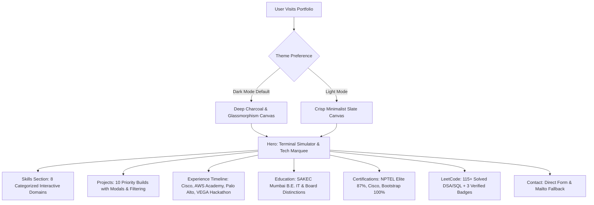

<div align="center">


# ⚡ Omkar Narsale — Personal Portfolio 2.0

<p align="center">
  <strong>Turning Data Into Insights. Building Technology Into Solutions.</strong>
</p>

<p align="center">
  <em>Third-Year Information Technology Student at Shah and Anchor Kutchhi Engineering College (SAKEC), Mumbai</em>
</p>

<p align="center">
  <a href="https://omkar-portfolio.vercel.app/"></a>
  <a href="https://github.com/Omkar-narsale/omkar-portfolio"></a>
  <a href="https://leetcode.com/u/qlakbkpB58/"></a>
  <a href="https://www.linkedin.com/in/omkar-narsale-56b188330/"></a>
</p>

<p align="center">
  
  
  
  
  
  
  
</p>

---

</div>

## 📌 Table of Contents

- [Overview](#-overview)
- [System Architecture](#-system-architecture)
- [Key Features & User Experience](#-key-features--user-experience)
- [Featured Projects Matrix](#-featured-projects-matrix)
- [Technical Skills & Tooling](#-technical-skills--tooling)
- [Verified Achievements & Certifications](#-verified-achievements--certifications)
- [LeetCode & Problem Solving](#-leetcode--problem-solving)
- [Quick Start & Local Setup](#-quick-start--local-setup)
- [Vercel Deployment Guide](#-vercel-deployment-guide)
- [Interactive Resume](#-interactive-resume)
- [Contact & Socials](#-contact--socials)

---

## 🚀 Overview

**Omkar Narsale — Personal Portfolio 2.0** is an enterprise-grade developer portfolio built from the ground up with **React 19, TypeScript, Vite, and Tailwind CSS**.

Unlike standard static portfolios, Portfolio 2.0 reflects an engineer's practical capabilities across **Data Engineering, Machine Learning, Computer Vision, and Full-Stack Systems**. It features interactive filtering, responsive architecture modals, verified problem-solving statistics, and print-ready resume synchronization.

```
       [ Client Browser ]
               │
               ▼
   ┌───────────────────────┐
   │ React 19 + TypeScript │ ── Dynamic Theme (Dark/Light)
   │  Vite Bundler + SPA   │ ── Filterable Project Matrix & Modals
   └───────────────────────┘ ── Real-Time LeetCode Metrics & Badges
               │
               ▼
   ┌───────────────────────┐
   │    Vercel Edge Host   │ ── Clean URLs (/resume -> /resume.html)
   │   Static CDN Assets   │ ── Production Optimized Bundle (<100 kB gzip)
   └───────────────────────┘
```

---

## 📐 System Architecture



---

## ✨ Key Features & User Experience

- **🌓 Instant Theme Switching**: Flawless dark (`#060B13`) and light mode transition with zero flash (`FOUC`) powered by early script initialization and Tailwind classes.
- **💻 Interactive Code & Terminal Simulator**: Live code switcher on the hero showing real snippets for ETL pipelines, Groq LLaMA 3.3 diagnostics, 468-point face mesh tracking, and MERN booking lifecycles.
- **🔍 Real-Time Search & Category Filters**: Instant client-side search across skills and projects with multi-tag filtering.
- **🪟 Architecture Details Modal**: Deep-dive into any project to view complete system architecture, verification status, and feature checklists.
- **📄 Synchronized Printable Resume**: Seamless access to `/resume.html` with responsive print rules and one-click PDF generation.
- **⚡ Performance & Accessibility**: 100% responsive across mobile, tablet, and widescreen desktop layouts with zero horizontal overflow.

---

## 🏆 Featured Projects Matrix

<details open>
<summary><strong>Click to expand / collapse project showcase</strong></summary>

| Project | Category | Key Tech Stack | Status | Repository |
| :--- | :--- | :--- | :---: | :---: |
| **RetailFlow** | Data Engineering | Python, Pandas, MySQL, SQLAlchemy, Watchdog, Power BI | `Verified Build` | [GitHub Repo](https://github.com/Omkar-narsale/RetailFlow-Analytics-Platform) |
| **NetSage AI** | AI & Cyber | Python, Groq LLaMA 3.3, Streamlit, Plotly, Pydantic | `62 Tests Passed` | [GitHub Repo](https://github.com/Omkar-narsale/NetSage-AI) |
| **MIRRORFIT XR** | Computer Vision | Python, OpenCV, MediaPipe, PyTorch | `Tested Prototype` | [GitHub Repo](https://github.com/Omkar-narsale/MirrorFit-Real-Time-Face-Tracking) |
| **Fixly / FixNear** | Full-Stack MERN | React 19, Node.js, Express, MongoDB Atlas, Tailwind CSS | `Full-Stack MVP` | [GitHub Repo](https://github.com/Omkar-narsale/Fixly-Local-Services) |
| **Sam.AI** | Generative AI | Python, Streamlit, TinyLlama, Hugging Face Transformers | `Open Source` | [GitHub Repo](https://github.com/Omkar-narsale/Sam-AI-Tnyllama-Chatbot) |
| **Diabetes Risk Dashboard** | Data Analytics | Power BI, DAX, Power Query, Data Modeling | `Completed` | [GitHub Profile](https://github.com/Omkar-narsale) |
| **HR Analytics Dashboard** | Business Intelligence | Power BI, DAX, Excel Workforce Modeling | `Completed` | [GitHub Profile](https://github.com/Omkar-narsale) |
| **War & Macro Dashboard** | Data Analytics | Power BI, Commodities & Inflation Time-Series Analysis | `Completed` | [GitHub Profile](https://github.com/Omkar-narsale) |
| **Hospital Management** | Full-Stack | Python, Flask, MySQL, Bootstrap | `Verified` | [GitHub Profile](https://github.com/Omkar-narsale) |
| **ResumeIQ** | AI / Career Tech | Python, LangChain, Sentence Transformers, FastAPI | `In Progress` | [GitHub Profile](https://github.com/Omkar-narsale) |
| **EduGuard AI** | AI / Full-Stack | FastAPI, PostgreSQL, React, Machine Learning | `Hackathon Build` | [GitHub Profile](https://github.com/Omkar-narsale) |
| **Data Cleaning SQL** | Data Engineering | SQL, MySQL, Window Functions, Data Hygiene | `Open Source` | [GitHub Repo](https://github.com/Omkar-narsale/Data-cleaning-using-SQL) |

</details>

---

## 🛠️ Technical Skills & Tooling

<details open>
<summary><strong>View all 8 categorized technical domains (Zero fake percentages)</strong></summary>

```yaml
Programming Languages:
  - Python
  - SQL
  - JavaScript (ES6+)
  - C

Data Analytics & Business Intelligence:
  - NumPy, Pandas, Matplotlib, Seaborn
  - Power BI, DAX, Power Query, Excel
  - Exploratory Data Analysis (EDA), Statistical Analysis, Data Cleaning

Database & Data Engineering:
  - MySQL, PostgreSQL, MongoDB, SQLite
  - Automated ETL Pipelines, Incremental Data Loading
  - Data Validation, Data Transformation, SQLAlchemy

Artificial Intelligence & Machine Learning:
  - Generative AI, LangChain, Hugging Face
  - LLM Integration (Groq API, TinyLlama, LLaMA 3.3)
  - Prompt Engineering, Sentence Transformers, Vector Similarity

Computer Vision:
  - OpenCV, MediaPipe Face Mesh, PyTorch
  - Facial Landmark Detection, Head Pose Estimation, 3D Virtual Try-On

Web Development:
  - React 19, TypeScript, Vite, Tailwind CSS, Bootstrap
  - Node.js, Express, Flask, FastAPI, Django

Cloud & DevOps:
  - AWS (EC2, S3, IAM, Cloud Foundations)
  - Vercel, Render, Git, GitHub
  - MongoDB Atlas, Neon PostgreSQL

Cybersecurity & Networking:
  - Cisco Packet Tracer, Wireshark, CCNA Concepts
  - Network Security, Access Control (NAC), SQL Injection Mitigation
```

</details>

---

## 🏅 Verified Achievements & Certifications

- **🎓 NPTEL Elite Certification (87%)**: *Principles of Modern CDMA/MIMO/OFDM Wireless Communications* — IIT Kanpur (July–Sept 2026).
- **💡 Bootstrap Training Certification (100% Score, 2 Credits)**: EduPyramids, SINE IIT Bombay & SWAYAM Plus (Cert ID: `47563922YR`).
- **🌐 Cisco AICTE Virtual Internship (2026)**: Artificial Intelligence Program (Student ID: `STU679b8dca09b921738247626`).
- **🌐 Cisco Networking Academy**: SYIT2-SLA Component-Networking Basics (Score: 80% — Advanced Level).
- **☁️ AWS Academy Cloud Virtual Internship**: AICTE-EduSkills (Grade E: 80–89, Cert ID: `8e650fa144ee80cf41fa82e53e70d858e`).
- **🛡️ Palo Alto Networks Cybersecurity Internship**: AICTE-EduSkills (Grade E: 80–89, Cert ID: `bc8fc5aac2760456fad3895c98517e59`).
- **🏆 VEGA Hackathon 2026**: 12-hour SIH-inspired hackathon sprint with ₹50,000 prize pool track ([Repo](https://github.com/Smeet-Chothani/Vega_hacks)).

---

## 💡 LeetCode & Problem Solving

- **Profile**: [leetcode.com/u/qlakbkpB58](https://leetcode.com/u/qlakbkpB58/)
- **Solutions Repository**: [github.com/Omkar-narsale/Leetcode-Solution](https://github.com/Omkar-narsale/Leetcode-Solution)
- **115+ Solved Problems** across Python Data Structures & Algorithms and SQL 50 query patterns.
- **Verified Badges**:
  - 🏅 **100 Days Badge 2026**: Continuous algorithmic problem-solving streak.
  - 🏅 **50 Days Badge 2026**: 50 days of active LeetCode challenges.
  - 🏅 **SQL 50 Badge**: Window functions (`ROW_NUMBER`, `DENSE_RANK`), CTEs, and complex joins.

---

## 💻 Quick Start & Local Setup

### 1. Prerequisites
- **Node.js**: v18.0.0 or higher (v20+ recommended)
- **npm** or **pnpm** or **yarn**

### 2. Installation
```bash
# Clone the repository
git clone https://github.com/Omkar-narsale/omkar-portfolio.git

# Navigate into the project folder
cd omkar-portfolio

# Install dependencies
npm install
```

### 3. Development Mode
```bash
npm run dev
```
Open [http://localhost:3000](http://localhost:3000) to view the live hot-reloading development server.

### 4. Build for Production
```bash
npm run build
npm run preview
```
The optimized production bundle will be generated in `dist/`.

---

## 🚢 Vercel Deployment Guide

This project contains native Vercel configuration in `vercel.json`:
```json
{
  "buildCommand": "npm run build",
  "outputDirectory": "dist",
  "cleanUrls": true,
  "trailingSlash": false,
  "rewrites": [
    { "source": "/resume", "destination": "/resume.html" },
    { "source": "/resume.html", "destination": "/resume.html" },
    { "source": "/((?!assets/|.*\\..*).*)", "destination": "/index.html" }
  ]
}
```

Whenever you push to the `main` branch, Vercel automatically:
1. Detects Vite.
2. Installs dependencies and runs `npm run build`.
3. Deploys the SPA to global edge CDN with instant cache invalidation.

---

## 📄 Interactive Resume

The verified printable resume is available at:
- **Web route**: [`/resume.html`](https://omkar-portfolio.vercel.app/resume.html) or [`/resume`](https://omkar-portfolio.vercel.app/resume)
- **Direct print**: Features an interactive top banner that invokes `window.print()` with CSS `@media print` optimizations to generate clean, A4-formatted PDF documents.

---

## 📬 Contact & Socials

- 📧 **Email**: [narsaleomkar2006@gmail.com](mailto:narsaleomkar2006@gmail.com)
- 💼 **LinkedIn**: [linkedin.com/in/omkar-narsale](https://www.linkedin.com/in/omkar-narsale-56b188330/)
- 🐙 **GitHub**: [github.com/Omkar-narsale](https://github.com/Omkar-narsale)
- ⚡ **LeetCode**: [leetcode.com/u/qlakbkpB58](https://leetcode.com/u/qlakbkpB58/)

---

<div align="center">
  <sub>Built with ❤️ by <strong>Omkar Narsale</strong> · SAKEC Mumbai · 2026</sub>
</div>
